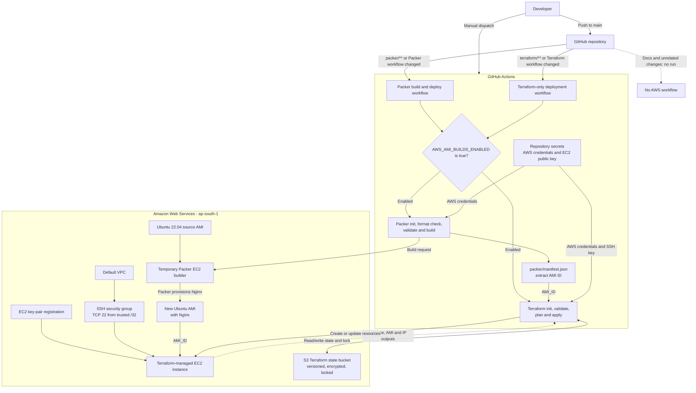

# Golden AMI

Golden AMI automates the creation and deployment of a reusable Ubuntu-based
Amazon Machine Image (AMI). Packer builds an Ubuntu 22.04 image with Nginx,
then Terraform provisions an EC2 instance from that image in AWS.

The project separates image creation from infrastructure deployment: Packer
changes produce a new AMI and deploy it, while Terraform-only changes reuse the
AMI already recorded in Terraform state.

## Architecture



The Packer workflow builds an image and immediately deploys it through
Terraform. The Terraform-only workflow does not build an image; it reads
`instance_ami_id` from the existing Terraform state before planning changes.
The S3 bucket is created separately by the state-bootstrap configuration and
is not managed by the application deployment workflow.

## What it does

- Builds a uniquely named Ubuntu 22.04 AMI with Nginx using Packer.
- Validates infrastructure changes and provisions an EC2 test instance with
  Terraform.
- Persists Terraform state in an encrypted, versioned S3 bucket with state
  locking.
- Restricts SSH ingress to a configured IPv4 `/32` and uses a supplied public
  key; the corresponding private key remains outside the repository.
- Runs the image-build and infrastructure-deployment workflows independently
  according to the files changed.

## Automation

GitHub Actions workflows are stored under `.github/workflows/`, the directory
GitHub uses to discover workflows. Both workflows also support manual dispatch.

| Change on `main` | Workflow behavior |
| --- | --- |
| Files under `packer/` or the Packer workflow | Build a new AMI, then pass its ID to Terraform to plan and apply the EC2 deployment |
| Files under `terraform/` or the Terraform workflow | Read the current AMI ID from Terraform state, then plan and apply infrastructure changes without rebuilding the AMI |
| Documentation or unrelated files | No AWS workflow is triggered |

The deployment jobs run only when the repository variable
`AWS_AMI_BUILDS_ENABLED` is set to `true`.

## Repository layout

```text
.
├── .github/
│   └── workflows/       # Packer build/deploy and Terraform-only workflows
├── packer/              # Packer template and environment variable files
└── terraform/           # EC2 infrastructure and S3 state bootstrap
```

Packer writes its build manifest to `packer/manifest.json`; the generated file
is intentionally excluded from version control.

## Technology

- [Packer](https://developer.hashicorp.com/packer) with the Amazon EBS builder
- [Terraform](https://developer.hashicorp.com/terraform) with the AWS provider
- Amazon EC2 and Amazon S3
- GitHub Actions
